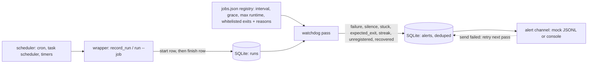

# job-watchdog

Scheduled jobs fail in two ways: loudly, with a stack trace nobody reads, and silently, by not running at all.
A job that stops running sends no error, so the only way to notice is to know when it should have run.

## What it does

- **A run table.** Every job run is one row in SQLite: start, finish, ok, exit code, duration, a JSON bag of counts, and the error text.
- **A tiny wrapper.** Jobs record themselves with a context manager (`record_run`) or by being launched through the CLI (`run --job NAME -- command`). The row is written at start and completed at the end, so a job that dies mid run leaves a visible unfinished row.
- **A watchdog.** One pass reads the table, compares it to a registry of expected jobs, and raises alerts:

| Kind | Severity | When |
| --- | --- | --- |
| `failure` | critical | a run ended non zero and that exit code is not whitelisted |
| `silence` | critical | no run started within `interval_minutes + grace_minutes` |
| `silence` | warning | a registered job has never recorded a run |
| `stuck` | warning | a run has been unfinished for longer than `max_runtime_minutes` |
| `expected_exit` | info | a whitelisted non zero exit; the alert carries the written reason |
| `expected_exit_streak` | warning | a whitelisted exit repeated `escalate_after` times in a row |
| `unregistered` | warning | the run table has a job the registry does not list |
| `recovered` | info | a healthy run closed earlier open alerts |

Some jobs exit non zero on purpose ("nothing to import today"). Those codes go in a per job whitelist, and **a whitelist entry without a written reason is rejected when the registry loads**. A whitelisted exit is never paged as a failure, still counts as proof the job is alive, and can escalate if it repeats suspiciously often.

Each alert is stored once per `(job, kind, ref)`, so a pass every minute does not repeat itself. If the alert channel is down, the alert stays undelivered in the table and is retried on the next pass.

No dependencies outside the Python standard library (pytest for the tests).

## Architecture



## Run it

```bash
cp jobs.example.json jobs.json
python -m job_watchdog run --job lead-import -- python -c "import sys; sys.exit(3)"
python -m job_watchdog check
```

The second command records a run that exits 3, which `jobs.example.json` whitelists for `lead-import` with a reason. The third runs one watchdog pass and prints what it raised (the other example jobs have never run, so it says so). `python -m job_watchdog status` prints one line per job.

`check` exits 1 when it raised anything above info, so the watchdog can itself be scheduled and watched.

Inside Python jobs, use the wrapper directly:

```python
from job_watchdog import connect, record_run

conn = connect("watchdog.db")
with record_run(conn, "invoice-sync") as run:
    run.counts["invoices"] = sync_invoices()   # exceptions are recorded, then re-raised
    # run.exit_code = 3                        # a by design non zero outcome
```

Configuration is two files and a few environment variables, see `.env.example` and `jobs.example.json`:

```json
{
  "name": "lead-import",
  "interval_minutes": 30,
  "grace_minutes": 10,
  "allowed_exits": [
    {"code": 3, "reason": "source inbox was empty, nothing to import", "escalate_after": 6}
  ]
}
```

## Tests

```bash
python -m pip install -r requirements-dev.txt
python -m pytest -q
```

53 tests cover the wrapper, registry validation, every alert kind, dedupe, recovery, channel outage and retry, the CLI, and a check that the demo still produces `demo/output.txt` byte for byte. CI (`.github/workflows/ci.yml`) runs the same on Python 3.10 and 3.12.

## Demo

```bash
python demo/run_demo.py
```

The demo replays 33 hours of invented job history through the real wrapper on a fake clock, then runs five watchdog passes against a mock channel. It needs no network, no keys and no files outside the repo, and its output is deterministic. The full capture is in [`demo/output.txt`](demo/output.txt). The first pass:

```text
== Mon 08:59 UTC  first pass over 33 hours of history
   raised 14, delivered to mock channel 14
   [CRITICAL] invoice-sync: silence: no run for 5h 54m; expected every 1h 0m (grace 15m), overdue by 4h 39m
   [INFO    ] lead-import: expected_exit: exit 3 is by design: source inbox was empty, nothing to import
   ... (7 more of the same)
   [WARNING ] lead-import: expected_exit_streak: exit 3 is whitelisted (source inbox was empty, nothing to import) but has now happened 6 runs in a row; check that it is still by design
   [CRITICAL] report-export: failure: run 215 failed with exit 1 after 95.0s: PermissionError: cannot write /srv/reports/daily.csv
   [WARNING ] cache-warm: stuck: run 231 started 14m ago and never finished (limit 5m); it is hung or it died without reporting
   [WARNING ] review-digest: silence: registered but no run has ever been recorded; is it scheduled, and does it go through the wrapper?
   [WARNING ] tmp-cleanup: unregistered: runs are being recorded for a job the registry does not list, so nobody is watching it for failure or silence
```

The later passes show no repeats when nothing changed, recovery notices once the jobs run cleanly again, and an alert held during a channel outage and delivered on the next pass.

## Where this pattern runs

This is a clean rewrite of a pattern drawn from systems that run two small service companies day to day, where a few dozen scheduled jobs (syncs, imports, exports, backups, digests) keep the office moving and nobody is employed to stare at logs. The run table plus a watchdog that reads it is what turned "we found out on Thursday that the sync stopped on Monday" into a message within the hour. All data, job names and history in this repo are synthetic.

## Limitations

- **Channels are mock and console only.** There is no email, chat or pager integration. A channel is any object with `send(alert)`, so adding one is small, but it is not here.
- **Intervals, not calendars.** A job is "every N minutes". There is no cron expression parsing, no business hours and no holiday awareness, so a weekday only job needs an interval and grace wide enough to cover the weekend.
- **Info alerts are not batched.** Every whitelisted exit produces one info alert. A real channel would want to route info to a digest instead of a phone.
- **A job that never ran alerts on the first pass.** There is no "expected to start by" date for new jobs.
- **No renotify.** An open alert is sent once. If nobody acts, the watchdog does not nag; `status` shows what is still open.
- **The watchdog needs watching too.** If the watchdog pass itself stops being scheduled, nothing here notices. Its exit code is there so an outer monitor can.
- **Single SQLite file.** Fine for jobs on one host or a shared volume with modest write rates. Jobs on many hosts would need a server database, and the wrapper opens no retry loop for a locked file beyond the SQLite default timeout.
- **Durations are wall clock** differences between start and finish timestamps, and the run table is never pruned.
- **The wrapper cannot record a run it never started.** A job that bypasses the wrapper looks silent, which is the correct alarm but the wrong diagnosis.

License: MIT, see the LICENSE file.
