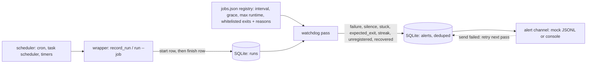

# job-watchdog

**Get told when a scheduled job fails, hangs, or quietly stops running.**

Cron jobs, Task Scheduler tasks and timers break in two ways. Some crash with an error nobody reads. Others just stop running, and a job that never starts sends no error at all, so the first sign is a customer asking where their invoice or report went.

job-watchdog is for anyone who depends on a handful to a few dozen scheduled jobs (syncs, imports, exports, backups) and has nobody watching logs. It does three things:

1. **Records every run** of every job in one small database table.
2. **Knows how often each job should run**, from a short config file.
3. **Raises an alert** when a job failed, when it has been silent for too long, or when it started and never finished. Each problem is alerted once, not on every check, and a "recovered" notice follows when the job is healthy again.

It is plain Python on the standard library and SQLite, about 700 lines, with 58 tests and an offline demo. The alert channels included are a console printer and a mock file writer; email, chat and pager delivery are not built (see [Limitations](#limitations)).

## What you will see

Real output from `python demo/run_demo.py`, which replays 33 hours of invented job history on a fake clock and then runs the watchdog. Shortened here (eight identical info lines cut to one, two later passes left out); the full capture is [`demo/output.txt`](demo/output.txt) and a test fails if the demo stops matching it.

```text
== Mon 08:59 UTC  first pass over 33 hours of history
   raised 14, delivered to mock channel 14
   [CRITICAL] invoice-sync: silence: no run for 5h 54m; expected every 1h 0m (grace 15m), overdue by 4h 39m
   [INFO    ] lead-import: expected_exit: exit 3 is by design: source inbox was empty, nothing to import
   [WARNING ] lead-import: expected_exit_streak: exit 3 is whitelisted (source inbox was empty, nothing to import) but has now happened 6 runs in a row; check that it is still by design
   [CRITICAL] report-export: failure: run 215 failed with exit 1 after 95.0s: PermissionError: cannot write /srv/reports/daily.csv
   [WARNING ] cache-warm: stuck: run 231 started 14m ago and never finished (limit 5m); it is hung or it died without reporting
   [WARNING ] review-digest: silence: registered but no run has ever been recorded; is it scheduled, and does it go through the wrapper?
   [WARNING ] tmp-cleanup: unregistered: runs are being recorded for a job the registry does not list, so nobody is watching it for failure or silence

== Mon 09:00 UTC  second pass, nothing changed: no repeats
   raised 0, delivered to mock channel 0

== Mon 09:30 UTC  jobs fixed and rerun: recoveries
   raised 4, delivered to mock channel 4
   [INFO    ] invoice-sync: recovered: run 234 finished cleanly; closed: silence
   [INFO    ] lead-import: recovered: run 233 finished cleanly; closed: expected_exit_streak
   [INFO    ] report-export: recovered: run 236 finished cleanly; closed: failure
   [INFO    ] cache-warm: recovered: run 232 finished cleanly; closed: stuck
```

The first line is the point: `invoice-sync` did not fail, it stopped being scheduled, and the watchdog noticed because it knew a run was due.

## How it works

- **A run table.** Every job run is one row in SQLite: start, finish, ok, exit code, duration, a JSON bag of counts, and the error text.
- **A tiny wrapper.** Jobs record themselves with a context manager (`record_run`) or by being launched through the CLI (`run --job NAME -- command`). The row is written at start and completed at the end, so a job that dies mid run leaves a visible unfinished row.
- **A watchdog.** One pass reads the table, compares it to a registry of expected jobs, and raises alerts:

| Kind | Severity | When |
| --- | --- | --- |
| `failure` | critical | a run ended non zero and that exit code is not whitelisted |
| `silence` | critical | no run started within `interval_minutes + grace_minutes` |
| `silence` | warning | a registered job has never recorded a run |
| `stuck` | warning | a run has been unfinished for longer than `max_runtime_minutes` |
| `expected_exit` | info | a whitelisted non zero exit; the alert carries the written reason |
| `expected_exit_streak` | warning | a whitelisted exit repeated `escalate_after` times in a row |
| `unregistered` | warning | the run table has a job the registry does not list |
| `recovered` | info | a healthy run closed earlier open alerts |

Some jobs exit non zero on purpose ("nothing to import today"). Those codes go in a per job whitelist, and **a whitelist entry without a written reason is rejected when the registry loads**. A whitelisted exit is never paged as a failure, still counts as proof the job is alive, and can escalate if it repeats suspiciously often.

Each alert is stored once per `(job, kind, ref)`, so a pass every minute does not repeat itself. If the alert channel is down, the alert stays undelivered in the table and is retried on the next pass.

How fast you hear about a problem depends on how often you schedule the watchdog pass: a silent job is flagged on the first pass after `interval_minutes + grace_minutes` has gone by.

Requirements: Python 3.10 or newer, linked against SQLite 3.35 or newer (it refuses to start on an older one). No dependencies outside the standard library; pytest for the tests.

## Architecture



## Run it

```bash
cp jobs.example.json jobs.json        # Windows cmd: copy jobs.example.json jobs.json
python -m job_watchdog run --job lead-import -- python -c "import sys; sys.exit(3)"
python -m job_watchdog check
python -m job_watchdog status
```

The `run` line records a run that exits 3, which `jobs.example.json` whitelists for `lead-import` with a reason, and passes the 3 through as its own exit code. `check` runs one watchdog pass; the other five example jobs have never run, so it prints:

```text
[WARNING ] nightly-backup: silence: registered but no run has ever been recorded; is it scheduled, and does it go through the wrapper?
[WARNING ] invoice-sync: silence: registered but no run has ever been recorded; is it scheduled, and does it go through the wrapper?
[INFO    ] lead-import: expected_exit: exit 3 is by design: source inbox was empty, nothing to import
[WARNING ] report-export: silence: registered but no run has ever been recorded; is it scheduled, and does it go through the wrapper?
[WARNING ] cache-warm: silence: registered but no run has ever been recorded; is it scheduled, and does it go through the wrapper?
[WARNING ] review-digest: silence: registered but no run has ever been recorded; is it scheduled, and does it go through the wrapper?
watchdog pass done: 6 new alert(s)
```

`check` exits 1 when it raised anything above info, or when any alert is still undelivered, so the watchdog can itself be scheduled and watched. `run` with a command that cannot be started records a failed run (exit 127) and prints one line instead of a traceback.

Inside Python jobs, use the wrapper directly:

```python
from job_watchdog import connect, record_run

conn = connect("watchdog.db")
with record_run(conn, "invoice-sync") as run:
    run.counts["invoices"] = sync_invoices()   # exceptions are recorded, then re-raised
    # run.exit_code = 3                        # a by design non zero outcome
```

Configuration is two files and a few environment variables, see `.env.example` and `jobs.example.json`:

```json
{
  "name": "lead-import",
  "interval_minutes": 30,
  "grace_minutes": 10,
  "allowed_exits": [
    {"code": 3, "reason": "source inbox was empty, nothing to import", "escalate_after": 6}
  ]
}
```

## Tests

```bash
python -m venv .venv
.venv/bin/python -m pip install -r requirements-dev.txt     # Windows: .venv\Scripts\python
.venv/bin/python -m pytest -q
```

58 tests cover the wrapper, registry validation, every alert kind, dedupe, recovery, channel outage and retry, the CLI, and a check that the demo still produces `demo/output.txt` exactly. CI (`.github/workflows/ci.yml`) runs the tests and the demo on Ubuntu with Python 3.10 and 3.12.

## Demo

```bash
python demo/run_demo.py
```

The demo pushes invented job history through the real wrapper on a fake clock, then runs five watchdog passes against the mock channel: the first pass shown above, a repeat pass that raises nothing, recoveries, and an alert held during a simulated channel outage and delivered on the next pass. It needs no network, no keys and no files outside the repo, and its output is the same on every run.

## Where this comes from

This is a clean rewrite of a pattern the author uses to keep an eye on the scheduled jobs of two small service companies. This repository is the demonstration version: what it proves is what its tests and demo show. All data, job names and history here are synthetic.

## Limitations

- **No real alert delivery.** The only channels are console (prints a line) and mock (appends JSON lines to a file). There is no email, chat, SMS or pager integration and none has been written or tested. A channel is any object with `send(alert)`, so adding one is small, but it is not here.
- **Never run against a real scheduler in this repo.** The tests and the demo drive everything with a fake clock and invented history. The CLI commands above were run by hand; nothing here has been left running under cron, systemd timers or Task Scheduler, and there are no uptime or detection time figures to quote.
- **The "channel outage" is simulated.** It is a flag on the mock channel (and, in one CLI test, an unwritable log path), not a real network failure.
- **Intervals, not calendars.** A job is "every N minutes". There is no cron expression parsing, no business hours and no holiday awareness, so a weekday only job needs an interval and grace wide enough to cover the weekend.
- **Stuck detection is opt in.** A run that never finishes is only flagged for jobs with `max_runtime_minutes` set. Without it, a job killed mid run is noticed only when it also goes silent.
- **Overlapping runs of one job are not modelled.** Any clean run closes that job's open alerts, including a failure or stuck alert that belongs to a different, still broken, run.
- **Some alerts close late or never.** A silence alert stays open until the next clean or whitelisted run, so a job that comes back but fails shows both `failure` and `silence` in `status`. An `unregistered` alert is never closed, even after the job is added to the registry.
- **Info alerts are not batched.** Every whitelisted exit produces one info alert. A real channel would want to route info to a digest instead of a phone.
- **A job that never ran alerts on the first pass.** There is no "expected to start by" date for new jobs.
- **No renotify.** An open alert is sent once. If nobody acts, the watchdog does not nag; `status` shows what is still open.
- **The watchdog needs watching too.** If the watchdog pass itself stops being scheduled, nothing here notices. Its exit code is there so an outer monitor can.
- **Single SQLite file.** Meant for jobs on one host. Concurrent writers rely on the SQLite default lock timeout with no retry, this has not been load tested, and jobs on many hosts would need a server database.
- **Durations are wall clock** differences between start and finish timestamps, and the run table is never pruned.
- **The wrapper cannot record a run it never started.** A job that bypasses the wrapper looks silent, which is the correct alarm but the wrong diagnosis. A process killed outright (SIGKILL, power loss) leaves an unfinished row; Ctrl-C and ordinary exceptions are recorded.
- **Tested on two platforms only.** CI is Ubuntu with Python 3.10 and 3.12; the suite and demo were also run on Windows with Python 3.12. `run --job` on Windows resolves commands the way `subprocess` does, without a shell.

License: MIT, see the LICENSE file.
